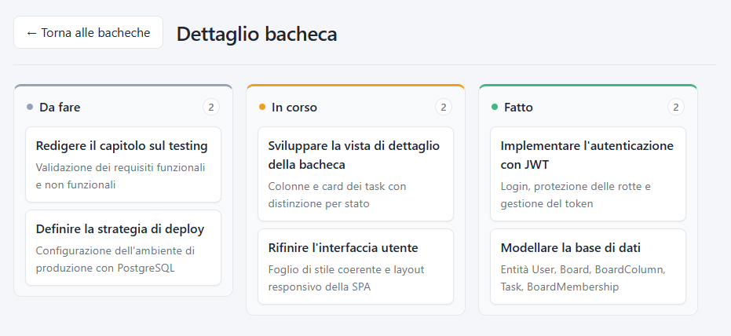

# Task Manager – Piattaforma Kanban per team

Piattaforma web full stack per la gestione dei task e delle attività di team aziendali, basata sulla metodologia **Agile/Kanban**.
Progetto sviluppato come tesi di laurea triennale in Ingegneria Informatica (Università Mercatorum).

    



## Funzionalità

- **Autenticazione** con login e token **JWT**, rotte protette lato frontend
- **Bacheche** (board) create dagli utenti, con il proprietario ricavato dal token
- **Colonne** ordinate all'interno di ogni bacheca (es. To Do, In Progress, Done)
- **Task** dentro le colonne: creazione, modifica, eliminazione
- **Membri della bacheca** con ruoli `ADMIN` e `MEMBER`: aggiunta e rimozione

## Architettura

```
frontend/  →  React SPA (Vite, React Router)
                │  chiamate REST + JWT nell'header Authorization
backend/   →  Spring Boot (Web MVC, Security, Data JPA, Validation)
                │
             Database H2 in memoria (sviluppo) · driver PostgreSQL incluso
```

Il backend segue una struttura a livelli: `controller` (API REST) → `service` (logica di business) → `repository` (accesso ai dati con JPA), con `dto` separati dalle entità del `model` e un pacchetto `security` dedicato a filtro e servizio JWT.

## API REST principali

| Metodo | Endpoint | Descrizione |
|---|---|---|
| POST | `/api/auth/login` | Login, restituisce il token JWT |
| POST / GET | `/api/users` | Registrazione ed elenco utenti |
| POST / GET | `/api/boards` | Crea una bacheca / elenco bacheche |
| GET | `/api/boards/{id}` | Dettaglio di una bacheca |
| GET / POST | `/api/boards/{boardId}/columns` | Colonne della bacheca |
| GET / POST | `/api/columns/{columnId}/tasks` | Task di una colonna |
| PUT / DELETE | `/api/tasks/{id}` | Modifica / elimina un task |
| GET / POST | `/api/boards/{boardId}/members` | Membri della bacheca |
| DELETE | `/api/boards/{boardId}/members/{userId}` | Rimuove un membro |

Nelle cartelle `backend/` e `frontend/` ci sono file `.http` pronti per provare le API da VS Code o IntelliJ.

## Avvio in locale

**Requisiti:** Java 25, Node.js 20+

```bash
# Backend (porta 8080)
cd backend
./mvnw spring-boot:run

# Frontend (porta 5173)
cd frontend
npm install
npm run dev
```

Il database H2 è in memoria e si azzera a ogni riavvio. In produzione la chiave per firmare i JWT andrebbe impostata come variabile d'ambiente invece che in `application.properties`.

## Sviluppi futuri

- Drag & drop dei task tra le colonne
- Database PostgreSQL persistente e deploy con Docker
- Test automatici su service e controller
- Funzionalità AI: generazione dei task da una descrizione, riepilogo dello sprint

## Autore

**Gianpaolo Gabancho Carrion** – Junior Full Stack Developer
[LinkedIn](https://www.linkedin.com/in/gianpaolo-gabancho-carrion/) · [GitHub](https://github.com/GGC-code)
